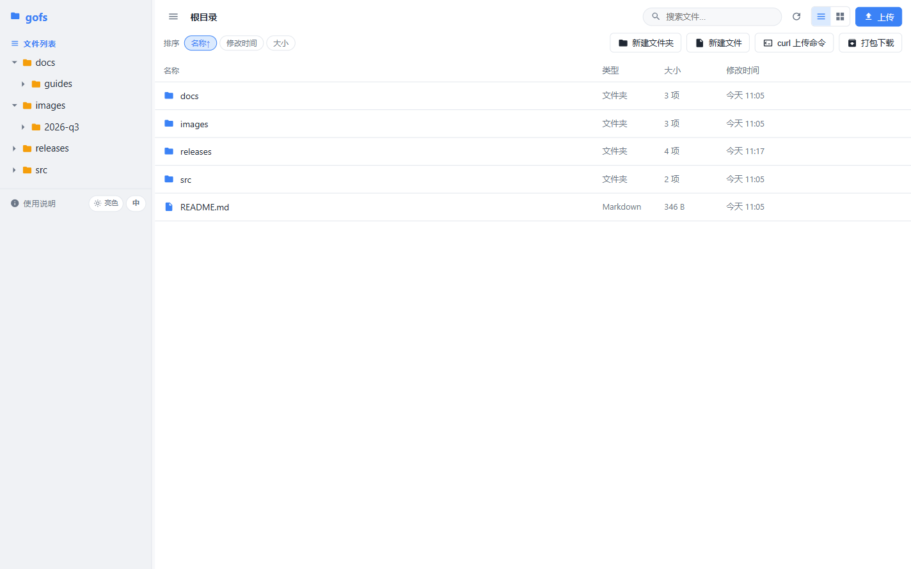
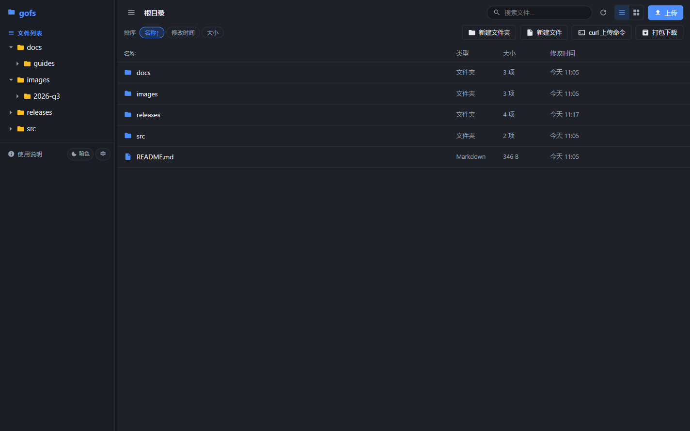
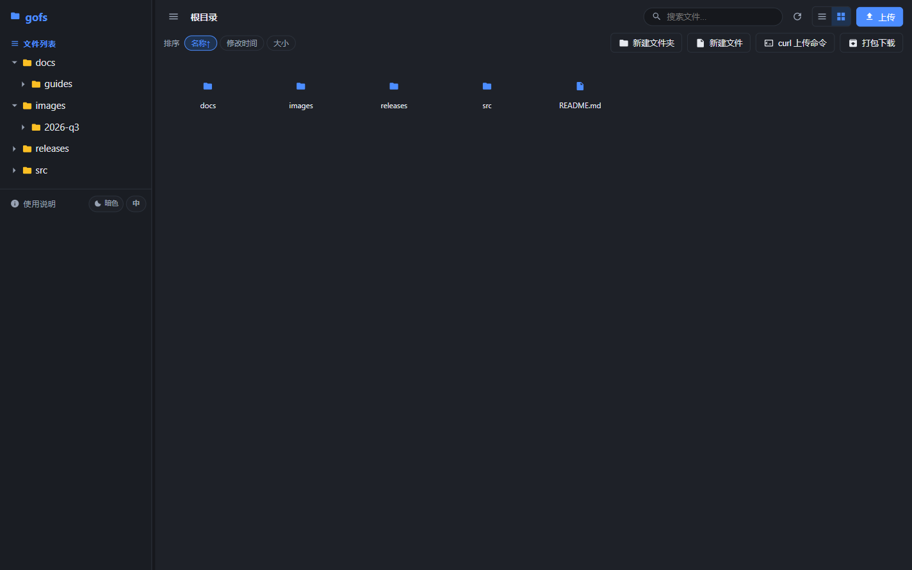
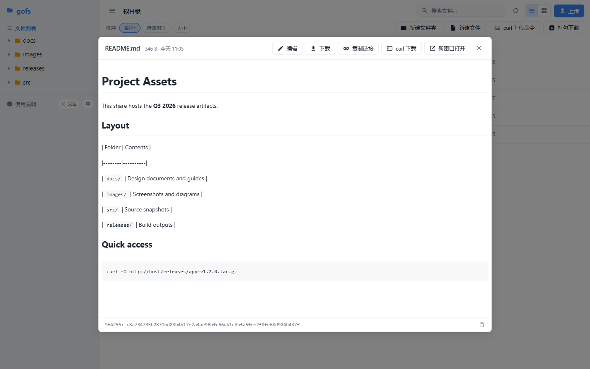
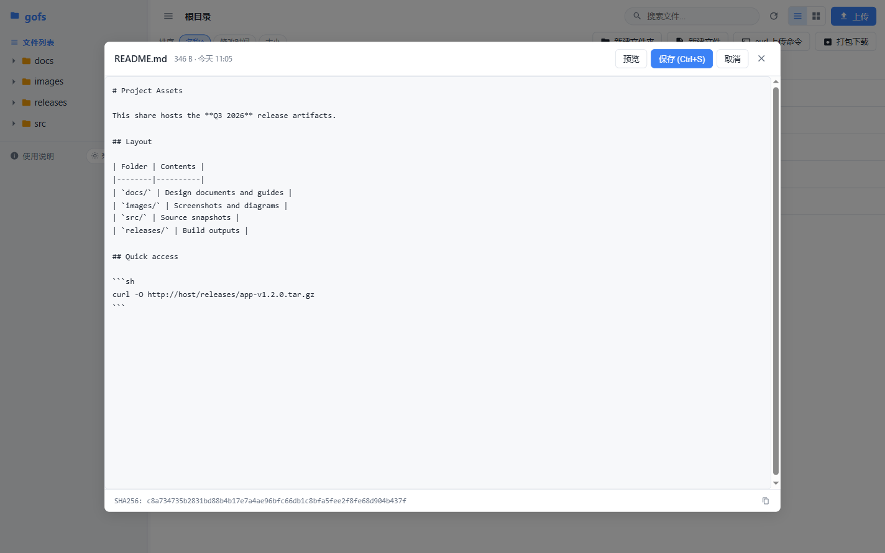
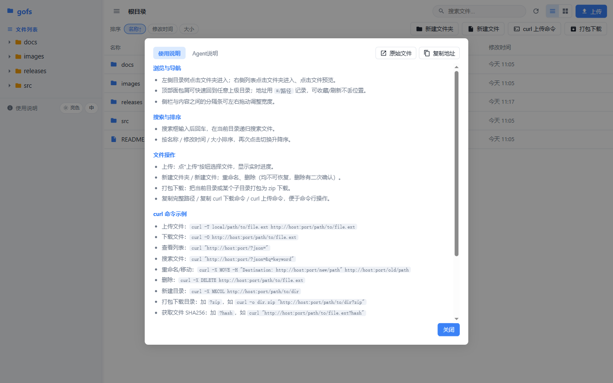
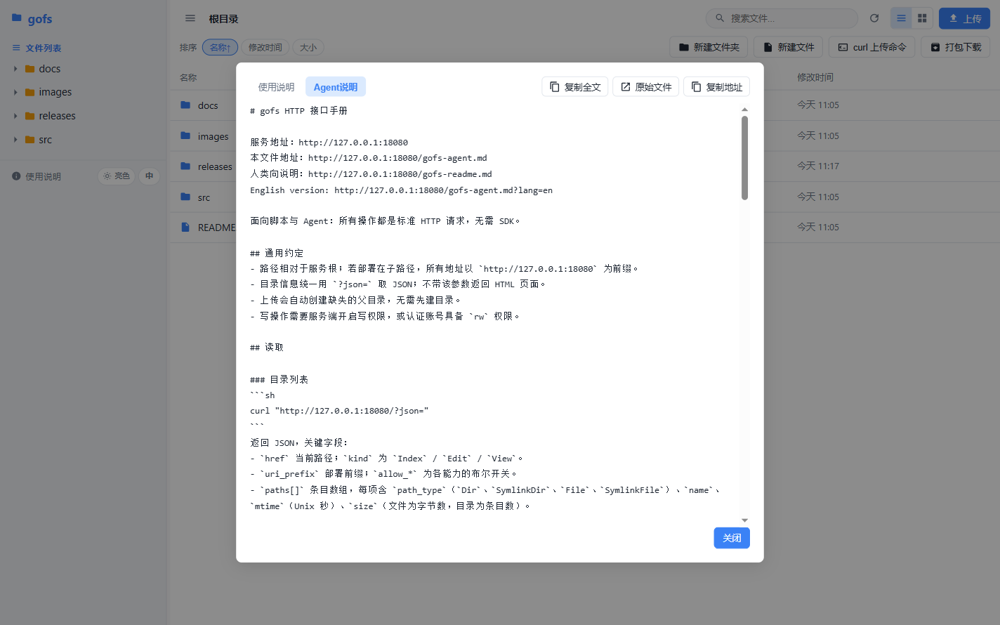
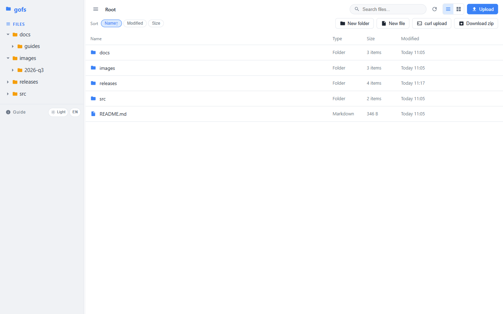
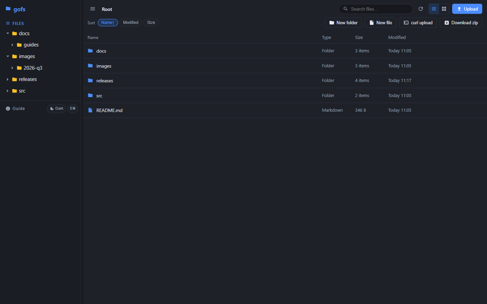

# gofs

**English** | [简体中文](README.zh-CN.md)

A distinctive utility file server — a Go reimplementation of [dufs](https://github.com/sigoden/dufs)
with a modern Vue 3 web UI.

Serves static files, uploads, searches, access control and WebDAV. The whole
thing — Go backend **and** the SPA frontend — compiles into a **single binary**
with no runtime dependencies beyond the Go standard library plus one tiny
logging package.



## Features

**Web UI** (Vue 3 + TypeScript, embedded in the binary)

- Split view: lazy-loading directory tree on the left, file list/grid on the right
- Breadcrumb navigation with hash-based routing (`#/path`) — deep links and
  reloads keep their position, entirely client-side
- **Light / dark / auto theme** and **Chinese / English UI**, both persisted
  in the browser
- In-browser preview: images, video, audio, PDF, Markdown, code, JSON, text
- In-place text editing with `Ctrl/Cmd+S` to save and a Markdown preview toggle
- Live upload progress, zip download of any folder, recursive search
- Drag the divider to resize the sidebar; long names truncate with an ellipsis

**Protocol / API**

- Static serving with HTTP range requests (`Range`, `If-Range`, ETag,
  `Last-Modified`, conditional requests)
- Directory listings as HTML, JSON (`?json`), plain names (`?simple`) or a
  text-client-friendly page (`?noscript`)
- Upload (`PUT`), resumable upload (`PATCH` + `X-Update-Range`), delete,
  `MKCOL`, `COPY`, `MOVE` and the rest of WebDAV
- Folder download as `.zip` (`?zip`), recursive search (`?q=`), SHA256
  (`?hash`), online editor (`?edit` / `?view`)
- Account-based access control: Basic and Digest auth, sha512-crypt passwords
  (`$6$...`), per-path read/write rules and tokens
- HTTPS via `--tls-cert` / `--tls-key`, unix socket via `--bind /path.sock`
- Health check at `__dufs__/health`
- **Two built-in virtual Markdown documents** (see below), generated per
  request and available in Chinese and English

## Screenshots

All screenshots below are real captures of the running application.

| Light | Dark |
|-------|------|
|  |  |

Grid view (dark theme):



Markdown preview and in-place editor:

| Preview | Edit |
|---------|------|
|  |  |

Built-in guide and agent manual (tabs in the help dialog):

| Guide | Agent manual |
|-------|--------------|
|  |  |

English UI:

| Light | Dark |
|-------|------|
|  |  |

## Build

Requires Go 1.24+.

```sh
# The built frontend assets are already committed under web/dist,
# so a plain build needs no Node.js at all:
go build -o gofs .
```

The web UI lives in `web/` (Vue 3 + Vite + TypeScript). Compiled assets in
`web/dist/` are committed and embedded via `//go:embed web/dist`, so `go build`
works without npm.

Only when you change the frontend do you need to rebuild it:

```sh
cd web
bash install-deps.sh          # npm install + npm run build
```

## Usage

```
gofs [OPTIONS] [serve-path]

Options:
  -c, --config <file>        Specify configuration file
  -b, --bind <addrs>         Specify bind address or unix socket
  -p, --port <port>          Specify port to listen on [default: 5000]
      --path-prefix <path>   Specify a path prefix
      --hidden <value>       Hide paths from directory listings, e.g. tmp,*.log,*.lock
  -a, --auth <rules>         Add auth roles, e.g. user:pass@/dir1:rw,/dir2
  -A, --allow-all            Allow all operations
      --allow-upload         Allow upload files/folders
      --allow-delete         Allow delete files/folders
      --allow-search         Allow search files/folders
      --allow-symlink        Allow symlink to files/folders outside root directory
      --allow-archive        Allow download folders as archive file
      --allow-hash           Allow ?hash query to get file sha256 hash
      --enable-cors          Enable CORS, sets `Access-Control-Allow-Origin: *`
      --render-index         Serve index.html when requesting a directory, returns 404 if not found index.html
      --render-try-index     Serve index.html when requesting a directory, returns directory listing if not found index.html
      --render-spa           Serve SPA (Single Page Application)
      --assets <path>        Set the path to the assets directory for overriding the built-in assets
      --log-format <format>  Customize http log format
      --log-file <file>      Specify the file to save logs to, other than stdout/stderr
      --compress <level>     Set zip compress level [default: low] [possible values: none, low, medium, high]
      --completions <shell>  Print shell completion script for <shell>
      --tls-cert <path>      Path to an SSL/TLS certificate to serve with HTTPS
      --tls-key <path>       Path to the SSL/TLS certificate's private key
  -h, --help                 Print help
  -V, --version              Print version
```

Options can also be set through `DUFS_*` environment variables (for example
`DUFS_PORT=5000`, `DUFS_AUTH=admin:123@/:rw`) or a YAML config file via
`--config`.

### Examples

```sh
# serve the current directory read-only
gofs

# allow all operations on a specific directory
gofs -A /srv/data

# read-only share with search and zip download (a typical public share)
gofs --allow-search --allow-archive --allow-hash --port 80 /srv/data

# require a username/password with write access
gofs -a 'admin:123@/:rw'

# HTTPS
gofs --tls-cert cert.pem --tls-key key.pem
```

## Built-in virtual documents

Two Markdown documents are generated on request, so the URLs inside them always
match the address the client actually used (friendly to reverse proxies and
`--path-prefix` deployments). A real file with the same name on disk takes
precedence.

| Path | Audience | Content |
|------|----------|---------|
| `/gofs-readme.md` | humans | features, UI usage, deployment notes |
| `/gofs-agent.md` | scripts / AI agents | complete HTTP + curl API reference |

Both are available in Chinese and English:

```sh
curl http://localhost:5000/gofs-agent.md             # Chinese (default)
curl 'http://localhost:5000/gofs-agent.md?lang=en'   # English
```

Without `?lang=`, the `Accept-Language` request header decides; Chinese is the
fallback. Responses carry `Content-Language` and `Vary: Accept-Language`.

The agent manual is also reachable from the web UI: **Guide → Agent guide**,
which can copy the whole manual to the clipboard in one click.

## curl quick reference

```sh
# list a directory as JSON
curl "http://localhost:5000/?json="

# search recursively
curl "http://localhost:5000/?json=&q=keyword"

# download a file
curl -O http://localhost:5000/path/to/file.ext

# upload a file (parent directories are created automatically)
curl -T local/file.ext http://localhost:5000/path/to/file.ext

# create a directory
curl -X MKCOL http://localhost:5000/path/to/dir

# rename / move
curl -X MOVE -H "Destination: http://localhost:5000/new/path" http://localhost:5000/old/path

# copy
curl -X COPY -H "Destination: http://localhost:5000/new/path" http://localhost:5000/old/path

# delete (recursive for directories)
curl -X DELETE http://localhost:5000/path/to/file.ext

# download a folder as zip
curl -o dir.zip "http://localhost:5000/path/to/dir?zip"

# get the SHA256 of a file
curl "http://localhost:5000/path/to/file.ext?hash"
```

See `/gofs-agent.md` for status codes, authentication, chunked uploads and the
full parameter table.

## Layout

| File | Purpose |
|------|---------|
| `main.go` | entry point, listener setup, signal handling |
| `args.go` | CLI / env / config parsing |
| `server.go` | HTTP + WebDAV request handling, embedded asset serving |
| `docs.go` | built-in virtual Markdown documents (bilingual) |
| `auth.go` | access control, Basic/Digest auth, sha512-crypt |
| `logger.go` | customizable access log format |
| `utils.go` | URI encoding, glob, range parsing, content types |
| `noscript.go` | text-client directory listing |
| `web/` | Vue 3 + TypeScript SPA source (Vite build) |
| `web/dist/` | built frontend, embedded into the binary with `go:embed` |
| `docs/screenshots/` | screenshots used by this README |

## License

MIT — see [LICENSE](LICENSE). Derived from [dufs](https://github.com/sigoden/dufs).
