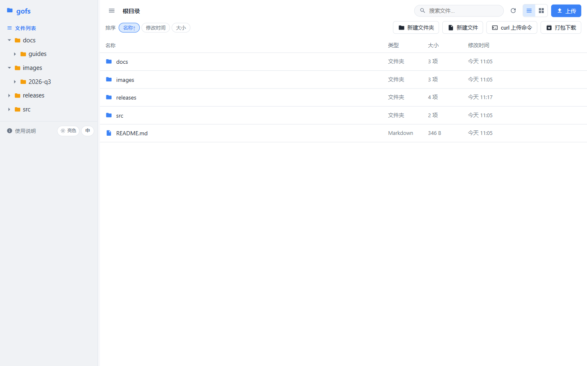
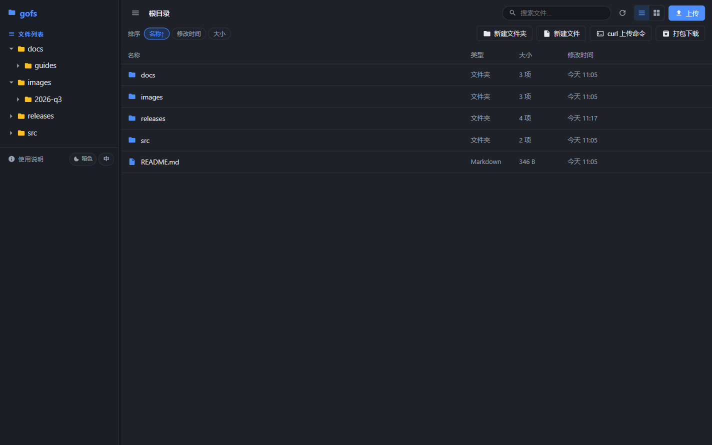
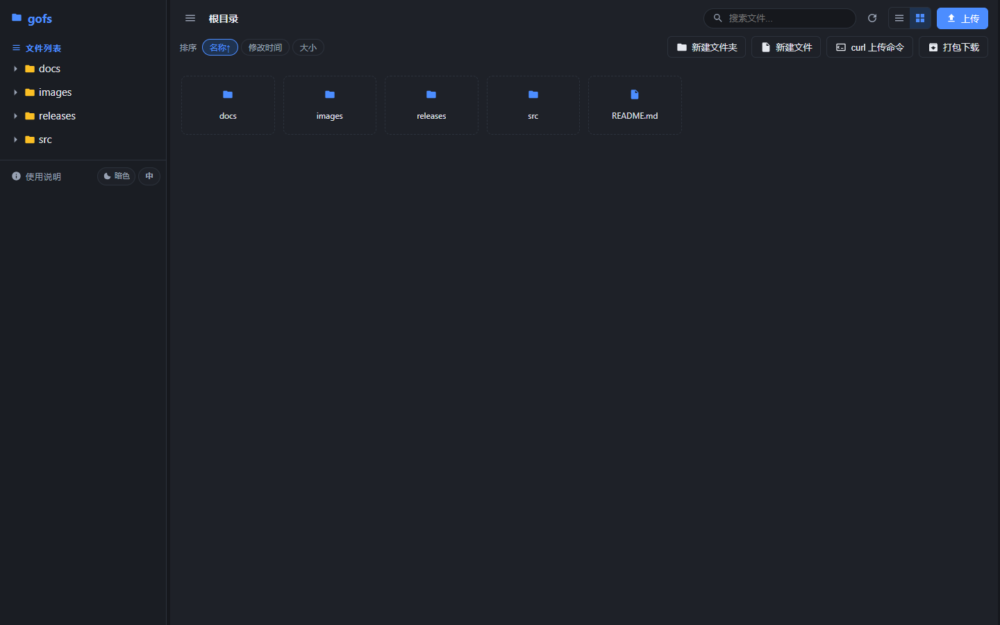
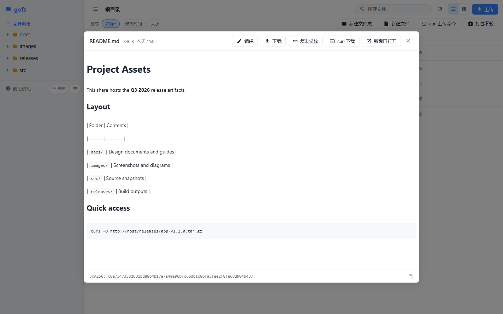
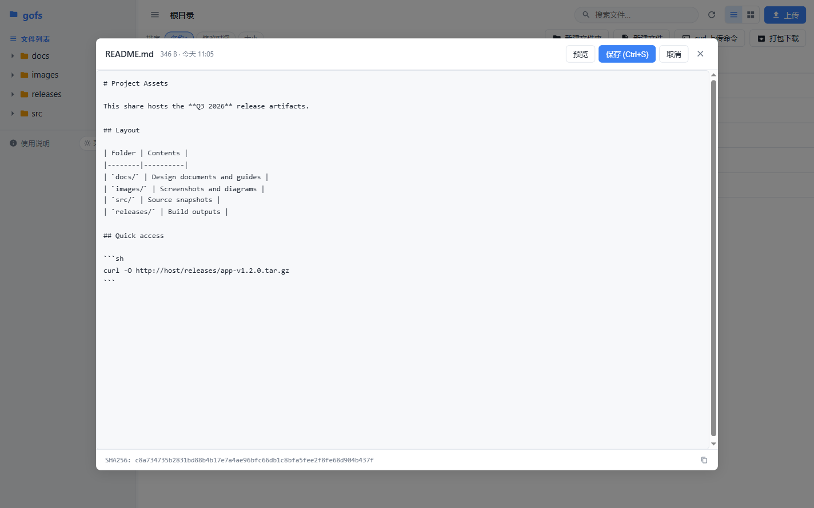
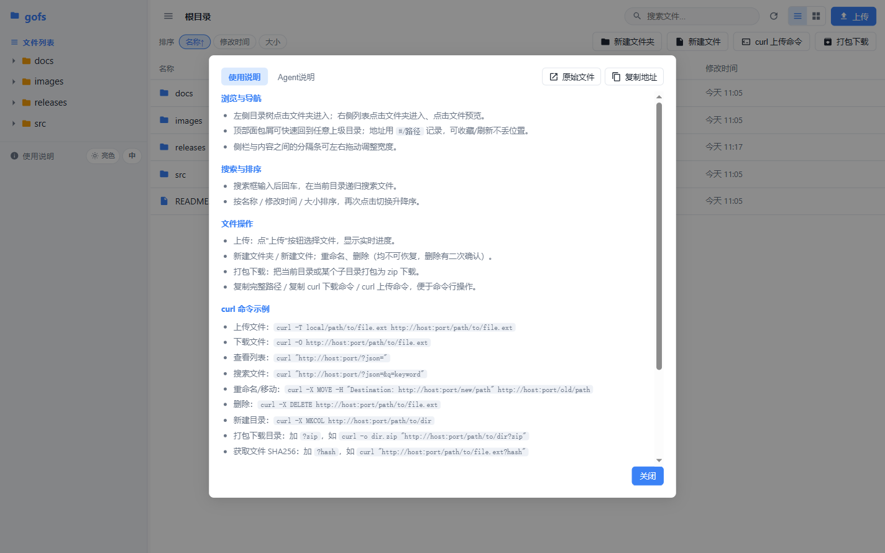
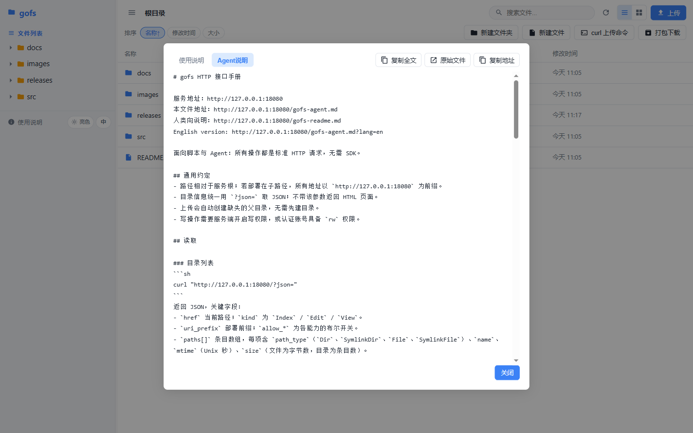
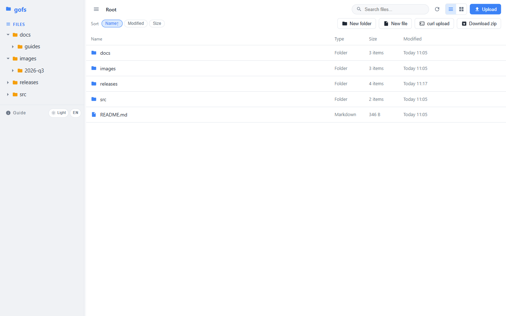
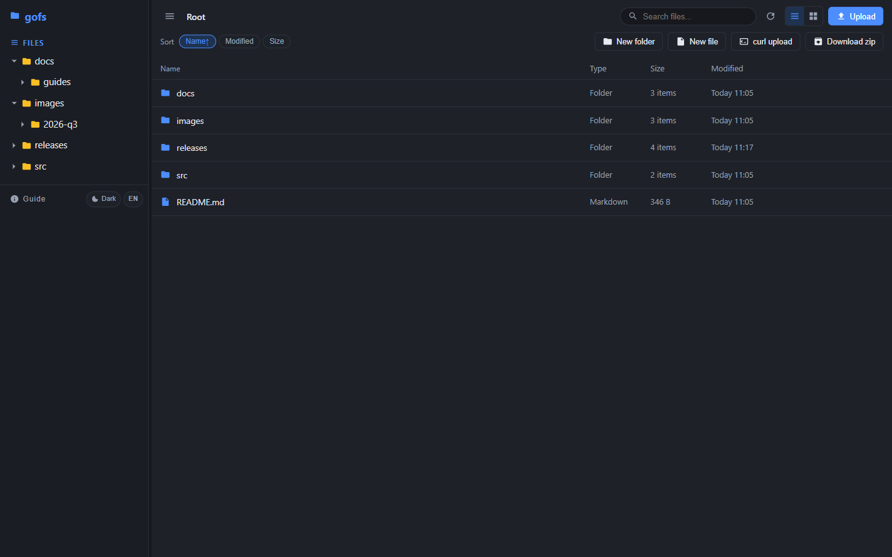

# gofs

[](https://github.com/zxysilent/gofs/actions/workflows/ci.yml)
[](https://github.com/zxysilent/gofs/actions/workflows/release.yml)
[](https://github.com/zxysilent/gofs/releases/latest)
[](LICENSE)

[English](README.md) | **简体中文**

一个别具一格的文件服务器 —— [dufs](https://github.com/sigoden/dufs) 的 Go 重实现，
带一套现代化的 Vue 3 网页界面。

支持静态文件服务、上传、搜索、访问控制与 WebDAV。整个项目 —— Go 后端**和** 前端 SPA
—— 都编译进**单个二进制文件**，运行时除 Go 标准库和一个极小的日志库外没有任何依赖。



## 功能特性

**网页界面**（Vue 3 + TypeScript，内嵌进二进制）

- 左右分栏：左侧为按需加载的目录树，右侧为列表 / 网格视图
- 面包屑导航 + 真实路径路由，深链和刷新都不丢当前位置，全程无整页加载
- **亮色 / 暗色 / 自动主题** 与 **中文 / 英文界面**，偏好保存在浏览器本地
- 在线预览：图片、视频、音频、PDF、Markdown、代码、JSON、纯文本
- Markdown 渲染支持 GFM 表格、**KaTeX 公式**（`$...$`、`$$...$$`、`\(...\)`、
  `\[...\]`）、**Mermaid 图表**（```` ```mermaid ```` 代码块），图片与链接按文档
  所在目录解析相对路径。两种渲染器都只在文档确实需要时才按需加载，
  切换亮色 / 暗色时图表会重新配色
- 文本就地编辑，`Ctrl/Cmd+S` 保存，Markdown 可切换预览
- 上传实时进度、任意目录打包下载、递归搜索
- 分隔条可拖动调整侧栏宽度；过长名称自动省略号截断

**协议 / 接口**

- 静态服务支持 HTTP range 请求（`Range`、`If-Range`、ETag、`Last-Modified`、条件请求）
- 目录列表支持 HTML、JSON（`?json`）、纯名称（`?simple`）以及面向文本客户端的页面（`?noscript`）
- 上传（`PUT`）、断点续传（`PATCH` + `X-Update-Range`）、删除、`MKCOL`、`COPY`、`MOVE`
  等完整 WebDAV 支持
- 目录打包下载 `.zip`（`?zip`）、递归搜索（`?q=`）、SHA256（`?hash`）、在线编辑器（`?edit` / `?view`）
- 基于账号的访问控制：Basic / Digest 认证、sha512-crypt 密码（`$6$...`）、按路径的读写权限与令牌
- 通过 `--tls-cert` / `--tls-key` 启用 HTTPS，通过 `--bind /path.sock` 使用 unix socket
- 健康检查：`/gofs-healthz`
- **两个内置虚拟 Markdown 文档**（见下文），按请求动态生成，且支持中英双语

## 界面截图

以下截图均为真实运行界面的捕获。

| 亮色 | 暗色 |
|------|------|
|  |  |

网格视图（暗色主题）：



Markdown 预览与在线编辑：

| 预览 | 编辑 |
|------|------|
|  |  |

内置使用说明与 Agent 手册（帮助弹窗中的两个标签页）：

| 使用说明 | Agent 说明 |
|----------|------------|
|  |  |

英文界面：

| 亮色 | 暗色 |
|------|------|
|  |  |

## 安装

每个 release tag 都会发布各平台预编译二进制，无需 Go 环境。

### 一行命令安装（Linux / macOS / FreeBSD）

```sh
curl -fsSL https://raw.githubusercontent.com/zxysilent/gofs/master/install.sh | bash
```

如果不希望把脚本通过管道交给 shell，也可以用子 shell 方式：

```sh
bash -c "$(curl -fsSL https://raw.githubusercontent.com/zxysilent/gofs/master/install.sh)"
```

脚本会自动识别系统与架构、下载对应压缩包、用官方 `SHA256SUMS` 校验完整性，
并把 `gofs` 安装到 `/usr/local/bin`。

指定版本，或安装到其他目录：

```sh
# 指定版本
curl -fsSL https://raw.githubusercontent.com/zxysilent/gofs/master/install.sh | bash -s -- --version 0.1.2

# 无需 sudo
curl -fsSL https://raw.githubusercontent.com/zxysilent/gofs/master/install.sh | bash -s -- --dir "$HOME/.local/bin"

# 也支持环境变量
GOFS_INSTALL_DIR="$HOME/.local/bin" bash -c "$(curl -fsSL https://raw.githubusercontent.com/zxysilent/gofs/master/install.sh)"
```

`install.sh --help` 可查看全部选项（`--dry-run` 试运行、`GOFS_BASE_URL` 指定镜像源、
`GOFS_VERIFY=0` 跳过校验）。

### 手动下载

从 [releases 页面](https://github.com/zxysilent/gofs/releases) 下载对应平台的压缩包，
校验后把二进制放进 `PATH`：

```sh
ver=0.1.2
base="https://github.com/zxysilent/gofs/releases/download/v${ver}"
curl -fsSLO "${base}/SHA256SUMS"
curl -fsSLO "${base}/gofs_${ver}_linux_amd64.tar.gz"
sha256sum -c <(grep 'linux_amd64' SHA256SUMS)
tar -xzf "gofs_${ver}_linux_amd64.tar.gz"
sudo install -m 0755 gofs /usr/local/bin/gofs
```

| 平台 | 架构 |
|------|------|
| Linux | `amd64`、`arm64`、`armv6`（armv7 机器同样可用）、`386` |
| macOS | `amd64`、`arm64`（Apple Silicon） |
| Windows | `amd64`、`arm64`（`.zip`） |
| FreeBSD | `amd64` |

压缩包命名规则为 `gofs_<版本>_<系统>_<架构>.tar.gz`（Windows 为 `.zip`），
内含二进制、`LICENSE` 和两份 README。

### systemd 服务示例

```ini
[Unit]
Description=gofs file server
After=network-online.target

[Service]
ExecStart=/usr/local/bin/gofs --port 80 --allow-search --allow-archive /srv/data
Restart=on-failure

[Install]
WantedBy=multi-user.target
```

## 从源码构建

需要 Go 1.24+。

```sh
# 前端产物已提交在 web/dist，因此普通构建完全不需要 Node.js：
go build -o gofs .
```

网页界面源码在 `web/`（Vue 3 + Vite + TypeScript）。编译产物 `web/dist/` 已提交，
并通过 `//go:embed web/dist` 内嵌进二进制，所以 `go build` 无需 npm。

只有在修改前端时才需要重新构建：

```sh
cd web
bash install-deps.sh          # npm install + npm run build
```

发布构建会在链接期写入版本号：

```sh
go build -trimpath -ldflags "-s -w -X main.version=0.1.2" -o gofs .
```

## 使用

```
gofs [OPTIONS] [serve-path]

Options:
  -c, --config <file>        Specify configuration file
  -b, --bind <addrs>         Specify bind address or unix socket
  -p, --port <port>          Specify port to listen on [default: 5000]
      --path-prefix <path>   Specify a path prefix
      --hidden <value>       Hide paths from directory listings, e.g. tmp,*.log,*.lock
  -a, --auth <rules>         Add auth roles, e.g. user:pass@/dir1:rw,/dir2
  -A, --allow-all            Allow all operations
      --allow-upload         Allow upload files/folders
      --allow-delete         Allow delete files/folders
      --allow-search         Allow search files/folders
      --allow-symlink        Allow symlink to files/folders outside root directory
      --allow-archive        Allow download folders as archive file
      --allow-hash           Allow ?hash query to get file sha256 hash
      --enable-cors          Enable CORS, sets `Access-Control-Allow-Origin: *`
      --render-index         Serve index.html when requesting a directory, returns 404 if not found index.html
      --render-try-index     Serve index.html when requesting a directory, returns directory listing if not found index.html
      --render-spa           Serve SPA (Single Page Application)
      --assets <path>        Set the path to the assets directory for overriding the built-in assets
      --log-file <file>      Specify the file to save logs to, other than stdout/stderr
      --log-level <level>    Set the log level [default: info] [possible values: debug, info, warn, error]
      --compress <level>     Set zip compress level [default: low] [possible values: none, low, medium, high]
      --completions <shell>  Print shell completion script for <shell>
      --tls-cert <path>      Path to an SSL/TLS certificate to serve with HTTPS
      --tls-key <path>       Path to the SSL/TLS certificate's private key
  -h, --help                 Print help
  -V, --version              Print version
```

所有选项也可通过 `GOFS_*` 环境变量设置（例如 `GOFS_PORT=5000`、
`GOFS_AUTH=admin:123@/:rw`），或用 `--config` 指定 YAML 配置文件。

### 示例

```sh
# 只读方式服务当前目录
gofs

# 对指定目录开放全部操作
gofs -A /srv/data

# 只读分享，开启搜索与打包下载（典型的公开共享配置）
gofs --allow-search --allow-archive --allow-hash --port 80 /srv/data

# 要求用户名/密码并具备写权限
gofs -a 'admin:123@/:rw'

# HTTPS
gofs --tls-cert cert.pem --tls-key key.pem
```

## 访问日志

每个请求两行结构化记录，共享同一个 `trace` —— 一行写请求，一行写结果。
不需要维护格式模板，也不会把时间戳再拼一次塞进引号包裹的消息里：

```
time=2026-11-10T15:53:31.244 level=INF trace=cfyk5fcc caller=xbegin ip=127.0.0.1 GET=/gamma
time=2026-11-10T15:53:31.244 level=INF trace=cfyk5fcc caller=xclose status=200 size=425 dur=116.841µs
```

请求行写"谁要了什么"，结果行写"结果如何"，每个字段只出现一次：

| 字段 | 所在行 | 含义 |
|------|--------|------|
| `trace` | 两行 | 请求 id，同时作为 `X-Request-ID` 响应头返回 |
| `caller` | 两行 | `xbegin` 或 `xclose` |
| `ip` | begin | 客户端地址 |
| `<METHOD>` | begin | 请求方法作字段名，路径与查询串作值（`GET=/a/b.md`） |
| `status` / `size` / `dur` | end | 响应状态码、响应体字节数、处理耗时 |
| `err` | end | 错误信息，仅出错时出现（error 级别） |

两行都是 info 级别，默认即可配对，无需额外开关：

```sh
grep 'trace=cfyk5fcc' gofs.log
```

请求若携带合法的上游 `X-Request-ID`（8–64 位字母数字）会直接复用，因此在反向
代理后面 trace 依然连贯。静态资源不记录访问日志。

## 内置虚拟文档

两个 Markdown 文档按请求动态生成，因此其中的地址始终与客户端实际访问的地址一致
（对反向代理和 `--path-prefix` 部署友好）。若磁盘上存在同名真实文件，则优先返回真实文件。

| 路径 | 面向对象 | 内容 |
|------|----------|------|
| `/gofs-readme.md` | 使用者 | 功能、界面用法、部署说明 |
| `/gofs-agent.md` | 脚本 / AI Agent | 完整的 HTTP + curl 接口参考 |

两者都支持中文和英文：

```sh
curl http://localhost:5000/gofs-agent.md             # 中文（默认）
curl 'http://localhost:5000/gofs-agent.md?lang=en'   # 英文
```

未指定 `?lang=` 时按 `Accept-Language` 请求头协商，最终回退为中文。响应会带上
`Content-Language` 与 `Vary: Accept-Language`。

在网页界面中也可以打开 Agent 手册：**使用说明 → Agent说明**，支持一键复制全文。

## curl 速查

```sh
# 以 JSON 列出目录
curl "http://localhost:5000/?json="

# 递归搜索
curl "http://localhost:5000/?json=&q=keyword"

# 下载文件
curl -O http://localhost:5000/path/to/file.ext

# 上传文件（会自动创建缺失的父目录）
curl -T local/file.ext http://localhost:5000/path/to/file.ext

# 新建目录
curl -X MKCOL http://localhost:5000/path/to/dir

# 重命名 / 移动
curl -X MOVE -H "Destination: http://localhost:5000/new/path" http://localhost:5000/old/path

# 复制
curl -X COPY -H "Destination: http://localhost:5000/new/path" http://localhost:5000/old/path

# 删除（目录会被递归删除）
curl -X DELETE http://localhost:5000/path/to/file.ext

# 目录打包下载
curl -o dir.zip "http://localhost:5000/path/to/dir?zip"

# 获取文件 SHA256
curl "http://localhost:5000/path/to/file.ext?hash"
```

状态码、认证方式、分片上传以及完整参数表见 `/gofs-agent.md`。

## 目录结构

| 文件 | 用途 |
|------|------|
| `main.go` | 入口、监听设置、信号处理 |
| `args.go` | 命令行 / 环境变量 / 配置文件解析 |
| `server.go` | HTTP + WebDAV 请求处理、内嵌资源服务 |
| `docs.go` | 内置虚拟 Markdown 文档（中英双语） |
| `auth.go` | 访问控制、Basic/Digest 认证、sha512-crypt |
| `logger.go` | 结构化访问日志（固定字段，按请求追踪 trace） |
| `utils.go` | URI 编码、glob、range 解析、内容类型 |
| `noscript.go` | 面向文本客户端的目录列表 |
| `web/` | Vue 3 + TypeScript SPA 源码（Vite 构建） |
| `web/src/markdown.ts` | Markdown 解析（表格、列表、公式/图表占位） |
| `web/src/math.ts` | KaTeX 按需加载与公式排版 |
| `web/src/diagram.ts` | Mermaid 按需加载、图表渲染与主题重绘 |
| `web/scripts/` | 构建后处理（剔除无用字体格式） |
| `web/dist/` | 构建后的前端产物，通过 `go:embed` 内嵌进二进制 |
| `install.sh` | 发布版安装脚本（一行命令安装） |
| `.github/workflows/` | CI 与发布流水线 |
| `docs/screenshots/` | 本 README 使用的截图 |

## CI / CD

全部定义在 `.github/workflows/`：

**`ci.yml`** —— 每次推送到 `master` 以及 Pull Request 时运行：

- Go：`gofmt` 检查、`go vet`、`go test -race`、构建
- 冒烟测试：启动二进制并验证 `/gofs-healthz`、JSON 目录列表、两套语言的虚拟文档
- 前端：`npm ci`、`vue-tsc --noEmit`、`npm run build`
- 一致性检查：若仓库中的 `web/dist` 与重新构建的结果不一致则失败（内嵌资源必须与源码匹配）

**`release.yml`** —— 推送 `v*` tag 时运行：

1. 以 `CGO_ENABLED=0` 交叉编译：linux（amd64/arm64/armv6/386）、darwin（amd64/arm64）、
   windows（amd64/arm64）、freebsd（amd64）
2. 把 tag 写入二进制（`-X main.version=<tag>`），并断言 `gofs --version` 输出该版本
3. 打包为 `gofs_<版本>_<系统>_<架构>.tar.gz`（Windows 为 `.zip`），附带 `LICENSE` 和两份 README
4. 生成 `SHA256SUMS`，创建带自动变更说明的 GitHub Release

发布新版本：

```sh
git tag v0.1.2
git push origin v0.1.2
```

安装脚本读取的就是该 release，因此一行安装命令始终跟随最新 tag。

## 许可证

MIT —— 见 [LICENSE](LICENSE)。源自 [dufs](https://github.com/sigoden/dufs)。
